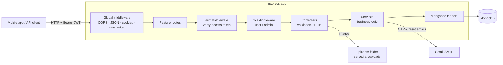
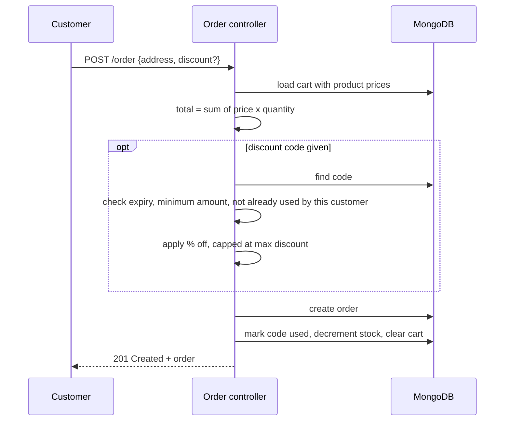

# Brandify

**A REST API that gives a local clothing brand its own online store: catalog, stock-aware cart, checkout with discount codes, reviews, and an admin back office.**

Many small clothing brands sell through social-media DMs: there's no real catalog, stock is tracked by hand, and discounts and orders live in chat threads. Brandify is the backend for a brand's own storefront app. Customers browse products by category, size and color, add items to a cart that checks stock, and check out with an optional discount code. The brand's admin manages the catalog, orders, discount campaigns and customer notifications.

> **Status:** the backend is feature-complete for the core shopping flow but not deployed. The Flutter mobile client was built separately and is not in this repository. See [Known limitations](#known-limitations--whats-next).

Built by a two-person team using feature branches and pull requests.

---

## Screenshots

<!-- TODO: add screenshots or a short GIF: Postman requests, the mobile app, the admin flow -->

| Product catalog | Cart & checkout | Admin: orders |
|---|---|---|
| _coming soon_ | _coming soon_ | _coming soon_ |

---

## Features

**Customers**
- Register, log in, verify email with a one-time code (OTP), reset password by email
- Short-lived JWT access token + refresh token in an `httpOnly`, `SameSite=strict` cookie (`/users/refresh`, `/users/logout`)
- Browse products with pagination and filters: price range, name/description search, sizes, colors, category/subcategory
- Cart with per-item customizations; quantities are checked against available stock
- Checkout: the order total is computed server-side from the cart, an optional discount code is applied, product stock is decremented and the cart is cleared
- Review products (rating + comment), list reviews per product, top 5 reviews
- In-app notifications with read/unread state

**Brand admin** (`admin` role)
- Product CRUD with up to 5 images per product (Multer; images only, 5 MB max each)
- Category and subcategory management
- Brand profile: name, description, logo, social links, contact info, store location
- Order management: list all orders (paginated, sortable), update status (`Pending → Processing → Delivered / Cancelled`), delete
- Discount codes: percentage off, minimum order amount, maximum discount cap, expiry date, one use per customer
- Notifications to one user or broadcast to everyone
- Paginated user list, delete users

**Cross-cutting**
- Role-based access control middleware (`user` / `admin`)
- Rate limiting: 100 req/min globally, 3 login attempts/min, 5 verification-email resends/min, 3 password-reset requests per 15 min per email
- Passwords hashed with bcrypt; login/register responses return only safe user fields
- Integration tests with Jest + Supertest against an in-memory MongoDB

## Tech stack

| Area | Tools |
|---|---|
| Runtime / framework | Node.js, Express 4 |
| Database | MongoDB, Mongoose 8 |
| Auth | JSON Web Tokens (access + refresh), bcrypt |
| Security | express-rate-limit, cookie-parser, CORS |
| Files & email | Multer (image uploads), Nodemailer (Gmail SMTP) |
| Testing | Jest, Supertest, mongodb-memory-server |

## Architecture

The code is organised **by feature**, not by layer. Each feature folder owns its routes, controller, service and Mongoose model, so a change to orders stays inside `features/order/`.



Checkout (`POST /order`):



```
Backend/
├── index.js                 # connects to MongoDB, starts the server
├── app.js                   # Express app: middleware + route mounting
├── config/db.js
├── middleware/
│   ├── authentication/      # JWT verification
│   ├── roles/               # role guard
│   ├── rateLimiter/         # global + per-route limits
│   └── fileUpload/          # Multer config
├── utils/                   # tokens, email, OTP generator, product filters
└── features/
    ├── users/  products/  Category/  subcategory/  Brand/
    ├── Cart/   order/     discount/  reviews/      notifications/
    └── (each: routes/ controllers/ services/ models/ [tests/])
```

## Getting started

**Prerequisites:** Node.js 18–24 and MongoDB (local or Atlas). Node 25+ is not supported yet: `jsonwebtoken`'s dependency chain uses a Buffer API that Node 25 removed.

```bash
git clone https://github.com/karim029/Brandify.git
cd Brandify/Backend
npm install
cp .env.example .env      # Windows: copy .env.example .env
# edit .env: set MONGO_URL and the two JWT secrets at minimum
npm run dev               # http://localhost:5000
```

### Environment variables

| Variable | Required | Example | Purpose |
|---|---|---|---|
| `PORT` | no | `5000` | HTTP port (default 5000) |
| `MONGO_URL` | yes | `mongodb://localhost:27017/brandify` | MongoDB connection string |
| `JWT_ACCESS_SECRET` | yes | long random string | Signs access tokens |
| `JWT_REFERESH_SECRET` | yes | long random string | Signs refresh tokens (spelled as in the code) |
| `JWT_ACCESS_EXPIRY` | no | `15m` | Access token lifetime (default `15m`) |
| `JWT_REFRESH_EXPIRY` | no | `7d` | Refresh token lifetime (default `7d`) |
| `EMAIL_USER` | for email | `you@gmail.com` | Gmail account that sends OTP / reset emails |
| `EMAIL_PASS` | for email | Gmail app password | A Gmail [app password](https://support.google.com/accounts/answer/185833), not the account password |

### Seed data

There's no seed script yet. To get an admin, register with `POST /users/register`, then set `role: "admin"` on that user in MongoDB (Compass or `mongosh`).

### Tests

```bash
cd Backend
npm test
```

Tests start their own in-memory MongoDB, so they never touch the database in your `.env`. They cover the Users and Products features.

## API

Base URL `http://localhost:5000`. 🔒 = needs `Authorization: Bearer <access token>`. 👑 = admin only. Responses use the shape `{ success, data?, message? }`.

| Method | Endpoint | Auth | Description |
|---|---|---|---|
| POST | `/users/register` | | Create account, sends email OTP |
| POST | `/users/verify-email` | | Verify email with OTP |
| POST | `/users/resend-email-verification` | | Resend OTP (rate-limited) |
| POST | `/users/login` | | Returns access token, sets refresh cookie (rate-limited) |
| POST | `/users/refresh` | cookie | New access token from the refresh cookie |
| POST | `/users/logout` | 🔒 | Clears the refresh cookie |
| POST | `/users/request-password-reset` | | Emails a reset link (rate-limited) |
| POST | `/users/reset-password/:token` | | Set a new password |
| GET, PUT | `/users/:id` | 🔒 | Get / update profile |
| GET | `/users` | 🔒👑 | Paginated user list |
| DELETE | `/users/:id` | 🔒👑 | Delete a user |
| GET | `/products` | | List products. Query: `page`, `limit`, `minPrice`, `maxPrice`, `name`, `sizes`, `colors`, `category`, `subCategory` |
| GET | `/products/:id` | | Product details |
| POST, PUT, DELETE | `/products`, `/products/:id` | 🔒👑 | Manage products (`multipart/form-data`, field `images`, max 5) |
| GET | `/Category`, `/Category/:name/products` | | Categories / products in a category |
| POST, PUT, DELETE | `/Category`, `/Category/:id` | 🔒👑 | Manage categories |
| GET | `/subcategory`, `/subcategory/:id` | | Subcategories |
| POST, PUT, DELETE | `/subcategory`, `/subcategory/:id` | 🔒👑 | Manage subcategories |
| GET | `/brand` | | Brand profile |
| POST, PUT, DELETE | `/brand` | 🔒👑 | Manage brand profile (field `logo`) |
| GET, POST, PUT, DELETE | `/Cart` | 🔒 | View cart, add item, change quantity, empty cart |
| DELETE | `/Cart/:productId` | 🔒 | Remove one item |
| POST | `/order` | 🔒 | Place an order from the cart, optional `discount` code |
| GET | `/order` | 🔒 | My orders (paginated) |
| GET | `/order/allOrders` | 🔒👑 | All orders (paginated, sortable) |
| GET, PUT, DELETE | `/order/:id` | 🔒👑 | Order details / update status / delete |
| POST, GET | `/discounts`, `/discounts/:code` | 🔒👑 | Create / look up / list active codes |
| PUT, DELETE | `/discounts/:code` | 🔒👑 | Deactivate / delete a code |
| GET | `/reviews?id=<productId>`, `/reviews/top?id=<productId>` | | Product reviews / top 5 |
| POST, DELETE | `/reviews`, `/reviews/:id` | 🔒 | Add / delete own review |
| POST | `/notifications` | 🔒👑 | Notify one user or broadcast |
| GET | `/notifications/:userId` | 🔒 | List notifications |
| PUT, DELETE | `/notifications/:id` | 🔒 | Mark as read / delete |

Full request/response examples for the Users API: [`Backend/features/users/documentation/readme.md`](Backend/features/users/documentation/readme.md).

## Known limitations & what's next

- **No payments.** Orders are created as `Unpaid`; there's no payment gateway yet.
- **Checkout isn't transactional.** Creating the order, decrementing stock and marking the discount as used are separate writes. A MongoDB transaction would stop two customers from buying the last item at the same moment.
- **Ownership checks.** `GET/PUT /users/:id` and `GET /notifications/:userId` require a logged-in user but don't yet check that the id is the caller's own.
- **Refresh tokens aren't stored or rotated**, so logout clears the cookie but can't revoke a token that was already issued.
- **Test coverage** is limited to Users and Products. Cart, Orders and Discounts need integration tests next.
- **Node 25+ unsupported** until the JWT library is swapped (e.g. for `jose`).
- No OpenAPI/Swagger docs, Docker setup, CI pipeline or seed script yet.
- Images are stored on local disk (`uploads/`); production would use object storage.
- The Flutter client is not in this repository.
